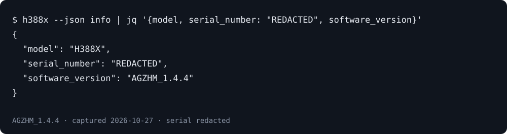

# H388X-CLI

[](https://github.com/alsd4git/h388x-cli/actions/workflows/tests.yml)
[](https://github.com/alsd4git/h388x-cli/releases)
[](LICENSE)

A command-line interface to manage your ZTE **H388X** modem (TIM HUB+),
firmware family **AGZHM_*** (tested on `AGZHM_1.4.4`).

Inspect modem status and manage supported settings from the terminal.
Commands return readable tables or JSON for scripts. Firmware support is
specific to the AGZHM family. The CLI does not support every H388X firmware.




## Quick start

You need Python 3.10 or later, [uv](https://docs.astral.sh/uv/getting-started/installation/),
access to your modem's local network and its WebUI administrator credentials.
Firmware differences matter; see the [AGZHM firmware notes](docs/usage-guide.md#notes-on-agzhm-firmware-quirks).

```bash
uv tool install "git+https://github.com/alsd4git/h388x-cli.git@v0.2.1"
h388x --help
```

Set `H388X_PASSWORD` in your process environment or a private configuration file
using the [configuration guide](docs/usage-guide.md#configuration). `H388X_HOST` defaults to
`192.168.1.1`; set it if your modem uses another address. Avoid putting the
password in command-line arguments or shell history.

Read device information without changing modem settings:

```bash
h388x --json info
```

The raw output includes your serial number. Keep it private. For a shareable
subset, the example below uses [jq](https://jqlang.org/) to replace the serial
and omit all other fields. Captured from a real H388X on 2026-10-27; only the
serial was replaced, and no network settings were changed:

```console
$ h388x --json info | jq '{model, serial_number: "REDACTED", software_version}'
{
  "model": "H388X",
  "serial_number": "REDACTED",
  "software_version": "AGZHM_1.4.4"
}
```

Continue with the [command reference](docs/usage-guide.md#command-reference) or the
[WebUI coverage inventory](docs/webui-coverage.md). This static walkthrough
uses the real captured output above.


<a id="commands"></a>

## Command reference

Start with these inspection commands:

| Command | Purpose |
| --- | --- |
| `h388x info` | Model and firmware information. |
| `h388x health` | Combined modem status overview. |
| `h388x stats` | DSL summary; `--watch N` refreshes it. |
| `h388x wan` | WAN connections and addressing. |
| `h388x devices` | Clients and DHCP reservations. |
| `h388x wifi` | Radio and SSID status. |
| `h388x capabilities` | Firmware capability and coverage inventory. |

Put `--json` before the subcommand, for example `h388x --json wan`.
For supported writes, options, and discovery commands, use the
[full command reference](docs/usage-guide.md#command-reference) and
[WebUI coverage inventory](docs/webui-coverage.md).

### Sensitive local output

Router output may contain serial numbers, MAC/IP addresses, device names or
credentials. Keep discovery reports and configuration backups private.
`devices export`, `discover` and configuration backup commands refuse to
overwrite existing files. Custom output paths still need local ignore rules.

`--json` changes formatting; it does not authorize writes. Deletion and reboot
commands require explicit confirmation or `--yes` in non-interactive mode.
Read the [output-safety details](docs/usage-guide.md#sensitive-local-output)
and [error-handling guide](docs/error-handling.md) before automation.

## Installation

The quick start uses the released Git tag. The guide also covers
[one-off execution, SSH installation and release assets](docs/usage-guide.md#installation).
For source development and shell completion, see
[local development](docs/usage-guide.md#local-development) and
[shell completion](docs/usage-guide.md#shell-completion).

## Configuration

See the [configuration guide](docs/usage-guide.md#configuration) for environment
variables, private configuration files, saved sessions and the optional
real-device smoke test. A modem session is a credential; do not commit it.

## Usage

The [usage recipes](docs/usage-guide.md#usage) include JSON output, live status
refresh, read-only inspection and operational commands. The preview image above
comes from the redacted device-information capture reproduced in the quick
start, recorded on 2026-10-27. It is a static capture, not a live status display.

## Notes on AGZHM firmware quirks

Support is firmware-specific. In particular, `renew-ip` is not available on
the observed AGZHM_1.4.4 firmware; rebooting instead interrupts connectivity.
Read the [firmware notes](docs/usage-guide.md#notes-on-agzhm-firmware-quirks)
before using write commands.

## Testing

Use the committed lockfile and fixture-based checks:

```sh
uv sync --locked --dev
uv run ruff check h388x_cli tests
uv run ruff format --check h388x_cli tests
uv run pytest
```

See [testing and optional device checks](docs/usage-guide.md#testing).
A live router is not required for the automated suite.

## License

MIT. See [LICENSE](LICENSE).
